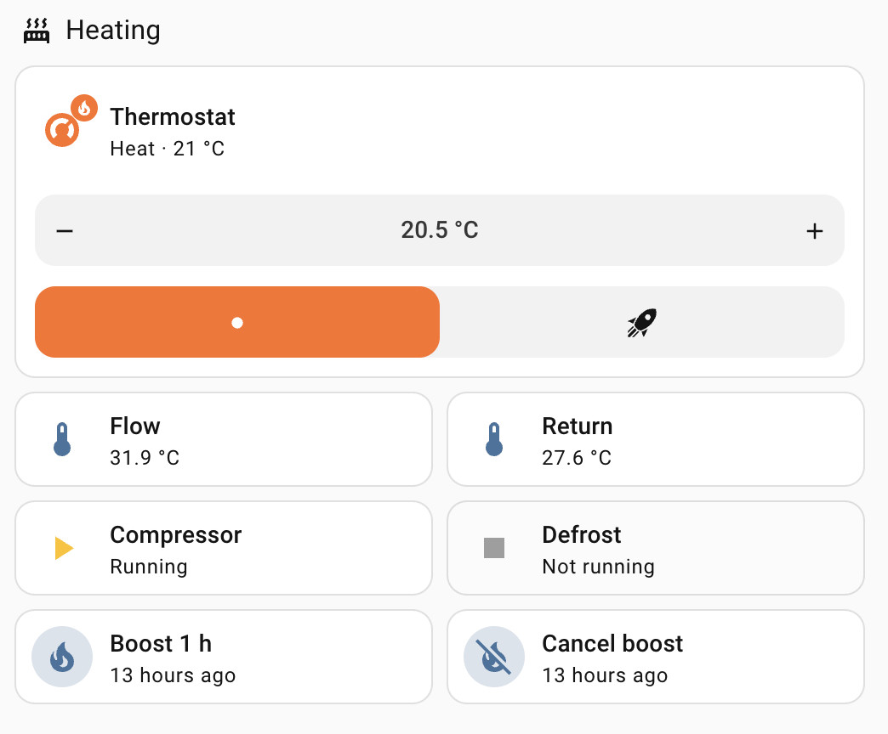
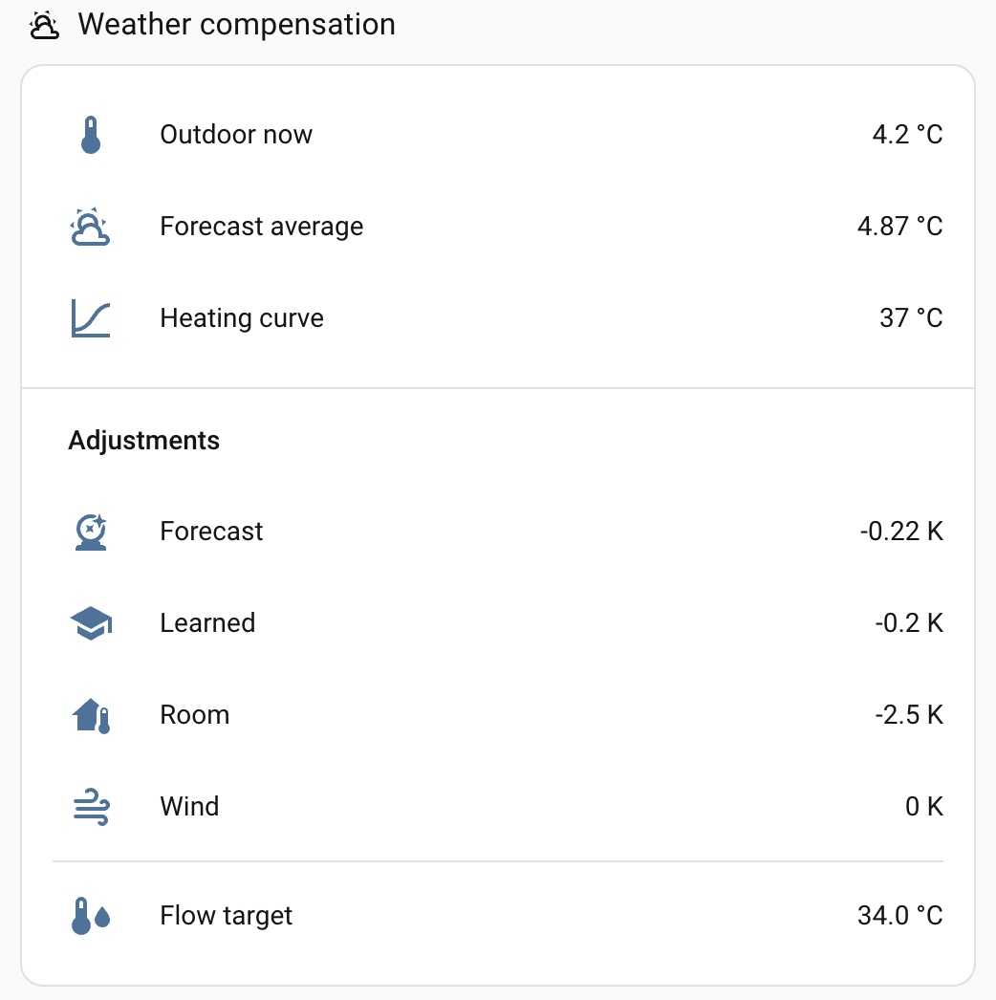
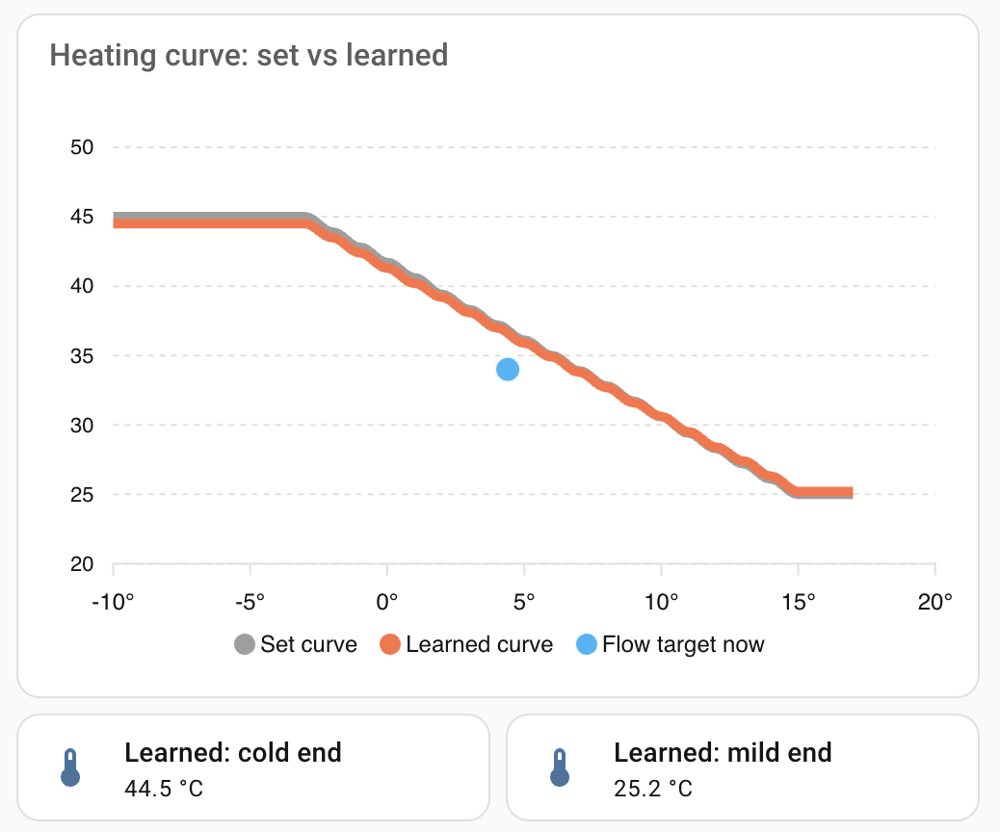
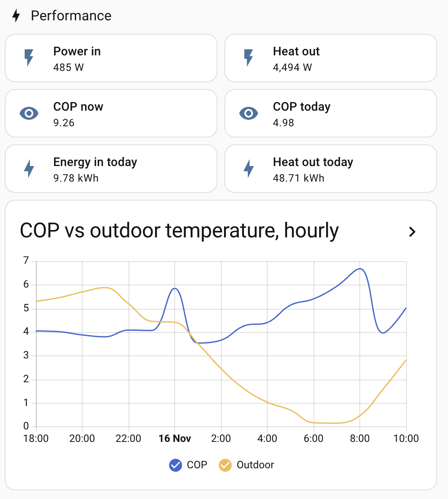

# Samsung EHS Heat Pump for Home Assistant

[](https://github.com/andyharding1983/ha-samsung-ehs/actions/workflows/validate.yml)
[](https://hacs.xyz/docs/faq/custom_repositories)

Local control of Samsung EHS air-to-water heat pumps through
Samsung's **MIM-B19N** Modbus interface module, with Home Assistant-side
**room thermostat with weather compensation** (forecast-aware, room influence, self-learning curve) and **COP tracking**.

No cloud, no SmartThings.

> **Uses Samsung's official interface only.** All communication goes through the Samsung
> MIM-B19N module's documented Modbus interface. Nothing is connected directly to the
> F1/F2 communication bus, and the heat pump's wiring and firmware are not modified. This
> is the approach recommended by the author, a registered Samsung installer, because it
> does not risk the warranty. Have the MIM-B19N fitted to Samsung's instructions.

> **Status: early release.** Running on one live install, a Samsung EHS with UFH and a
> MIM-B19N, since November 2026. All registers, including the extended ones, have been
> confirmed on that unit. Other models and setups haven't been tested yet. Please report
> results, good or bad, under [Issues](https://github.com/andyharding1983/ha-samsung-ehs/issues),
> and attach the diagnostics download.

## Features

| Platform | Entities |
|---|---|
| Climate | Room thermostat: Heat/Off, room target temperature, Boost preset |
| Water heater | Hot water on/off, Eco / Standard / Power / Force, tank target, optional time schedule (can be turned off for heating-only systems) |
| Sensor | Flow, return, ΔT, hot water tank, outdoor temp, flow rate, compressor frequency, heat output, electrical power, COP (instant / today / lifetime), heat and electrical energy, flow target, learned curve offset, error codes |
| Binary sensor | Heat demand, defrost, compressor running, problem |
| Switch | Quiet mode |
| Select | Heat emitter type: underfloor or radiators, which applies sensible presets |
| Number | Heating curve, thermostat and learning tuning |
| Button | Boost heating, boost hot water (1 h), cancel either, apply learned curve, reset curve learning |

📖 **[Full entity reference](docs/entities.md)**: every entity, attribute and setting explained, including
[flow target vs flow setpoint](docs/entities.md#flow-target-vs-flow-setpoint).

## Hardware

* Samsung **MIM-B19N** (or MIM-B19NT) connected to the indoor unit's F1/F2 bus.
* A USB–RS485 adapter wired to the MIM-B19N's **R1/R2** terminals (A/B).
* Serial settings are fixed by the module: **9600 baud, 8 data bits, even parity, 1 stop bit**.
* The Modbus address is set with the DIP switches (SW4/SW5) plus the rotary switch (SW1).
  Power-cycle the module after changing it.
* **Cable:** screened twisted pair. Screened Cat5e works well, e.g. Ubiquiti UISP Cable Pro.
  Use one twisted pair for A/B.
* **Termination:** fit a **120 Ω resistor across A/B at the heat pump (MIM-B19N) end** of the
  Modbus cable.

> **One Modbus master only.** Home Assistant must be the only master on the bus. If a Samsung
> **MIM-H04EN** Wi-Fi controller is fitted, disconnect it. Also disconnect anything else
> polling the MIM-B19N (a third-party controller, Home Assistant's built-in `modbus:` YAML,
> etc.). Two masters on one RS485 bus corrupt each other's traffic.

## Installation

1. HACS → ⋮ → *Custom repositories* → add `https://github.com/andyharding1983/ha-samsung-ehs`, category *Integration*.
2. Install **Samsung EHS Heat Pump** and restart Home Assistant.
3. *Settings → Devices & services → Add integration → Samsung EHS*.
4. Enter the serial port (prefer `/dev/serial/by-id/…`), the Modbus address and the indoor index (`0` for a single unit).

Then open **Configure** on the integration to set:

| Option | Used for |
|---|---|
| Hot water cylinder | Turn off on heating-only systems to hide all hot water controls |
| Hot water schedule | Optional Schedule helper: hot water on during its blocks, off outside ([details](docs/entities.md#hot-water-schedule)) |
| Room temperature sensor | Room influence (falls back to the Samsung controller's sensor) |
| Heat pump electrical power sensor | COP (W or kW, ideally a dedicated meter on the outdoor unit supply) |
| Weather forecast | Forecast blending for weather compensation |
| Outdoor temperature sensor override | Use instead of the heat pump's own outdoor sensor |
| Read extended registers | Outdoor temperature, flow rate and compressor frequency (see below) |

### Switching from the simulator to the real unit

Settings → Devices & services → Samsung EHS → ⋮ → **Reconfigure**. Enter the real serial port,
preferably the `/dev/serial/by-id/…` path. If you enter a `/dev/ttyUSB0` style path, it's
converted to the by-id link automatically. That name comes from the adapter's USB serial
number, so it doesn't change after reboots, updates or re-plugging. The integration checks it
can reach the MIM-B19N before saving. Your options and the learned curve are kept.

## Dashboard

A ready-made dashboard is in [`dashboards/samsung_ehs.yaml`](dashboards/samsung_ehs.yaml). It has sections
for heating, weather compensation (with the curve chart and learning history), hot water, and performance
(power, heat, COP).

| Heating | Weather compensation |
|:-:|:-:|
|  |  |
| **Heating curve: set vs learned** | **Performance** |
|  |  |

*Screenshots taken with the built-in simulator (see "Trying it without hardware"), so the values are illustrative.*

1. Create a new dashboard from scratch.
2. Open its **Raw configuration editor** and paste the file in.

The curve chart needs [ApexCharts card](https://github.com/RomRider/apexcharts-card). Everything else uses
built-in cards. The hot water section hides itself when hot water is turned off in the options. The
file's header has the details.

## Trying it without hardware

Enter `simulator` as the serial port. A simulated heat pump follows the outdoor temperature
from your chosen weather entity (or outdoor sensor override). It responds to setpoint writes,
reheats hot water and defrosts in cold weather. If no power sensor is configured, it also
supplies its own electrical power reading, so COP works. This is useful for trying out
weather compensation settings and dashboards before you connect the real unit.

## How heating is controlled

Home Assistant always controls the heat pump. The climate entity works like a normal room thermostat.
Set a room target and Home Assistant does the rest. Turn off the Samsung controller's own water-law
(WL) setting so the two don't fight.

### Weather-compensated flow temperature

```
effective_outdoor = (1 − w) · outdoor_now + w · mean(forecast over next N hours)
curve_flow        = straight line through (design outdoor, design flow) and (mild outdoor, mild flow)
room_offset       = clamp(gain · (room_target − room_temp), ±limit)
wind_offset       = clamp(wind gain · (wind − wind threshold), 0 … 3 K)
flow_setpoint     = clamp(curve_flow + adaptive_offset + room_offset + wind_offset, min flow, max flow), rounded to 0.5 °C
```

* **Forecast blending** starts warming the house before a cold snap and eases off before a mild
  spell. This matters for slow systems such as underfloor heating. Set the weight to `0` to disable it.
* **Room influence** reacts straight away to the room error. A gain of 3 means 1 °C below target
  raises the flow by 3 °C.
* **Wind boost** adds flow when it's windy. It uses the wind now plus the forecast wind over the
  look-ahead, so it starts before the room cools. The default is +0.3 °C per m/s above 5 m/s, up to +3 °C.
  Set the gain to `0` to turn it off.
* The **learned curve** adapts slowly. While space heating runs (not during defrost or hot water), the
  room error is learned separately at the **cold and mild ends of the curve**, so the curve's slope
  corrects itself as well as its level, and the room settles on target in all weathers. It won't wind
  up while the flow is held at its min/max, and it survives restarts. Press **Apply learned curve** to
  copy what it has learned into the curve points.
* **Min/max flow temperature** are the hard limits on the result. The curve itself keeps going in cold
  weather. Choose your **heat emitter type** (underfloor 25–45 °C, radiators 30–55 °C) to set sensible
  limits, curve and learning speed, then fine-tune.
* A new setpoint is only written when it changes by ≥ 0.5 °C, and at most every 5 min
  (configurable), to keep bus traffic and EEPROM writes low.

### Thermostat on/off

* When the room reaches **target + overshoot** (default 1 °C), space heating is switched off at the unit.
* It switches back on once the room has fallen **restart drop** (default 0.5 °C) below that
  point, so at target + 0.5 °C by default. The room is still above target at that moment, so
  room influence keeps the flow temperature low and the compressor restarts gently. Without
  this, it would wait until the room had already gone cold. That matters most for underfloor
  heating after a sunny afternoon: the floor slab takes hours to warm up again. Set the drop
  equal to the overshoot to restart at target instead.
* Above the **heating cut-off** effective outdoor temperature, heating stays off.
* **Minimum on time** (default 20 min) protects the compressor. With no minimum off time, that
  limits the unit to **3 starts per hour**. An optional minimum off time is also available.
  After a Home Assistant restart, the minimum on time starts again from that moment, so a
  restart can never cause a short cycle.
* **Compressor starts today** counts compressor starts, so you can see the effect of these
  settings.
* If the room sensor becomes unavailable, heating is never paused. It runs on weather
  compensation alone until the sensor comes back.
* Hot water is controlled separately and keeps working while space heating is paused.

The `Flow target` sensor shows the working: curve flow, adaptive offset, room offset,
effective outdoor temperature, forecast mean, heat demand and last write. The `Flow setpoint`
diagnostic sensor is the value the unit is actually using. See
[flow target vs flow setpoint](docs/entities.md#flow-target-vs-flow-setpoint).

### Boost

**Boost heating** (a button, or the climate entity's *Boost* preset) runs space heating at the maximum
flow temperature for one hour, even if the thermostat is satisfied or set to Off. Pressing it again
restarts the hour. **Cancel boost** ends it early. Nothing is learned during a boost. Afterwards normal
control resumes, and the minimum on time counts from the start of the boost. A restart of Home Assistant
cancels a boost.

### Seeing what it has learned

The two *Learned flow at cold end / mild end* sensors have a history graph that shows how the curve is
changing. There's an optional ApexCharts card that plots the set and learned curves against outdoor
temperature. See [docs/entities.md](docs/entities.md#viewing-the-learned-curve).

### Tuning tips

1. Get the curve roughly right. If the heat pump keeps pausing on overshoot, the curve is too high.
   If the learned offset keeps climbing, it is too low.
2. Lower the flow temperatures until the house *just* holds temperature. Lower flow means higher COP,
   and long steady runs beat on/off cycling.
3. Once the learned offsets have settled over a few weeks of varied weather, press **Apply learned curve**.
4. **Room influence:** the defaults (gain 3 K/K, limit 5 K) are cautious. A slow underfloor
   system with large solar gains may need much more. The first live install runs **gain 5 K/K
   and limit 10 K**, so that the flow drops well before the room overshoots. Ideally the
   compressor slows to its minimum and never needs the hard off at all.
5. Watch **Compressor starts today**. A few long runs a day is good. Dozens of starts means the
   overshoot or restart drop is too small, or the minimum output is more than the house needs.

## COP

* **Heat output** = flow rate (L/min) ÷ 60 × 4.18 kJ/kg·K × (flow − return).
* **COP** = heat output ÷ electrical power (blank below 100 W, capped at 10).
* **COP today / lifetime** use energy integrated from both, including defrost losses.

## Register map

From Samsung's MIM-B19N installation manual (Table 2). PDU addresses, indoor unit 0 (base 50):

| Addr | Value | Access |
|---|---|---|
| 0 | Module error status (bitfield) | R |
| 1 | Outdoor unit error code | R |
| 2 | Defrost (0 / 0xFF = off) | R |
| 52 | On/off | R/W |
| 53 | Mode (0 auto, 1 cool, 4 heat) | R/W |
| 59 | Room temperature ×10 | R |
| 63 | Indoor unit error code | R |
| 65 | Water in (return) ×10 | R |
| 66 | Water out (flow) ×10 | R |
| 68 | Water out setpoint ×10 (heat 15–55) | R/W |
| 72 | Hot water on/off | R/W |
| 73 | Hot water mode (0 eco, 1 std, 2 power, 3 force) | R/W |
| 74 | Hot water setpoint ×10 (30–70) | R/W |
| 75 | Hot water temperature ×10 | R |
| 78 | Quiet mode | R/W |
| 79 | Away mode | R/W |

### Extended registers

The MIM-B19N can expose extra NASA values that aren't in its standard register table.
You enable them by writing a list of NASA message IDs to holding register **6000**
(outdoor unit values) and **7000** (indoor unit values), all in one *Write Multiple
Registers* request (function code 16). This is the same method used by
[ZimKev/MIM-B19n_Modbus](https://github.com/ZimKev/MIM-B19n_Modbus), which lists many more
IDs.

**The integration does this for you.** You don't need an automation or a
`modbus.write_register` call. It sends the enable writes when it connects, and again after
any loss of communication, because the module forgets the list when it loses power. It
writes:

| Enable register | NASA IDs written | Values |
|---|---|---|
| 6000 | `0x8204`, `0x8238` | Outdoor temperature (×10 °C), compressor frequency (Hz) |
| 7000 | `0x42E9`, `0x4067` | Water flow rate (×10 L/min), 3-way valve (0 = heating, 1 = hot water) |

The values then appear as read-only registers in the order written. Outdoor values start at
address **4** and indoor values at **indoor base + 32**, which is **82** for indoor unit 0.
This was confirmed on a live unit:

| Read addr | NASA ID | Value | Live check |
|---|---|---|---|
| 4 | `0x8204` | Outdoor temperature ×10 | ✅ |
| 5 | `0x8238` | Compressor frequency (Hz) | ✅ |
| 82 | `0x42E9` | Water flow rate ×10 (L/min) | ✅ |
| 83 | `0x4067` | 3-way valve | ✅ mapped |

Addresses outside the mapped range answer with Modbus exception 2. Each value is read
separately, so a value the unit doesn't provide just shows as unknown. If something looks
wrong, please open an issue and attach the **diagnostics download** (Settings → Devices &
services → Samsung EHS → ⋮ → Download diagnostics). It includes a raw dump of registers
0–130, read just after the enable writes.

## Debug logging

```yaml
logger:
  logs:
    custom_components.samsung_ehs: debug
    pymodbus: info
```

## Author

Written by Andy Harding, a registered Samsung installer:
[www.hardingharding.co.uk](https://www.hardingharding.co.uk).

## Disclaimer

Not affiliated with or endorsed by Samsung. Samsung and the Samsung logo are trademarks of Samsung
Electronics Co., Ltd. They are used here only to identify compatible equipment. You use this at your own risk. The integration writes
setpoints to your heat pump, so keep an eye on it after installation.
